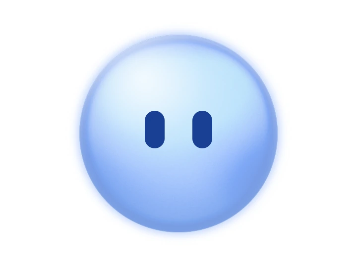
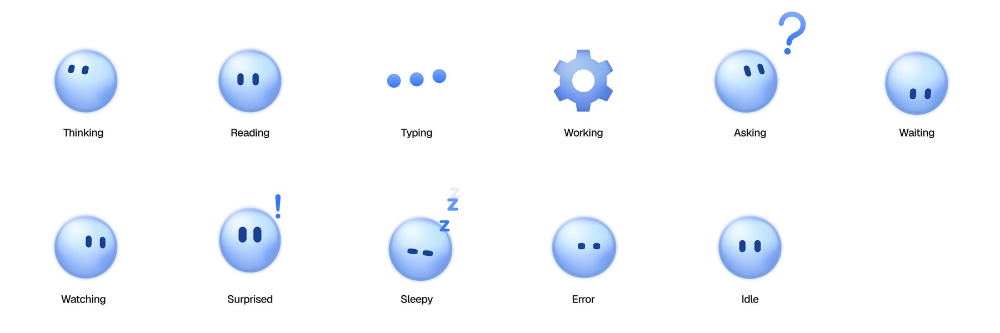

<p align="center">
  <picture>
    <source media="(prefers-color-scheme: dark)" srcset="docs/orbling-dark.webp" />
    
  </picture>
</p>

<h1 align="center">orbling</h1>

<p align="center">
  An open-source orb for AI chat. It shows what your assistant is doing, from thinking to asking a question.
  <br />
  <a href="https://orbling.vercel.app"><strong>orbling.vercel.app</strong></a>
</p>

<picture>
  <source media="(prefers-color-scheme: dark)" srcset="docs/moods-dark.jpg" />
  
</picture>

## Install

Tell your AI coding tool:

> Add orbling to this project using https://orbling.vercel.app/llms.txt

Or run:

```bash
npx shadcn@latest add https://orbling.vercel.app/r/orbling.json
```

## Use

```tsx
import { Orbling, OrblingStatus } from "@/components/orbling";

<Orbling mood="thinking" />
<OrblingStatus mood="working" />
```

`OrblingStatus` is the small orb with its mood written beside it, for a chat's status line.

## Moods

`idle` `thinking` `reading` `typing` `working` `asking` `waiting` `watching` `surprised` `sleepy` `error`

## Props

| Prop | Default | |
| --- | --- | --- |
| `mood` | `"idle"` | One of the moods above. |
| `size` | `72` | Diameter in px. |
| `palette` | `"sky"` | `"sky"`, `"mono"` or `"night"` for dark backgrounds. |
| `hue` | `0` | Turns the colours round the colour wheel, in degrees. |
| `heat` | `true` | The WebGL heat. Turn it off where many orbs show at once. |
| `label` | | Accessible name. Without it, screen readers skip the orb. |

---

MIT. Made by [Tables](https://www.tables.so). Heat by [Paper Shaders](https://shaders.paper.design).
